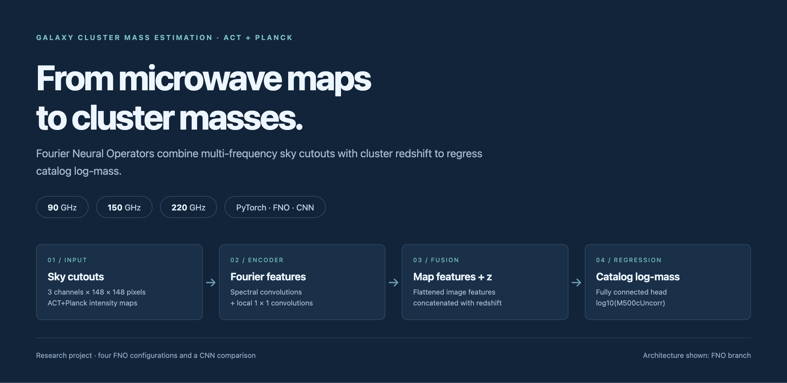
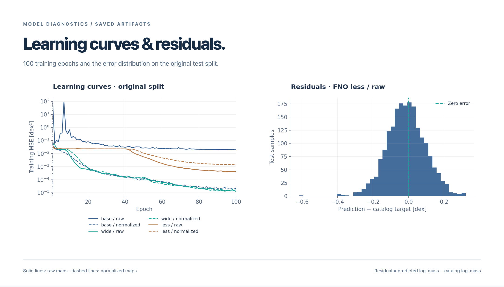

# Galaxy Cluster Mass Estimation



**Оценка масс скоплений галактик по трёхчастотным картам ACT+Planck с помощью FNO и CNN.**

Исследовательский проект: подготовка вырезок неба, обучение нейросетевых регрессоров и сравнение архитектур и вариантов обработки данных. Основные FNO-модели объединяют признаки изображения с красным смещением скопления и предсказывают `log10(M500cUncorr)` — логарифм каталожной оценки массы.

[Результаты](#результаты) · [Структура](#структура) · [Быстрый старт](#быстрый-старт) · [Ноутбуки](docs/notebooks.md) · [Воспроизведение](docs/reproduction.md)

## Что сделано

- Подготовка трёхканальных вырезок **148 × 148** из карт на **90, 150 и 220 ГГц** по координатам скоплений ACT DR6.
- Реализация спектральных свёрток и **Fourier Neural Operator** в PyTorch; две регрессионные головы, использующие красное смещение.
- Сравнение четырёх конфигураций FNO и CNN, исходных и нормализованных карт, аугментации массивных скоплений.
- Сохранение индексов выборок, истории обучения и предсказаний; анализ попарных ошибок и воспроизводимые иллюстрации.

## Модели

| Эксперимент | Модель | FNO-слои | Моды | Ширина | Голова |
| :--- | :--- | ---: | :---: | ---: | :--- |
| `fno_base` | `ModelFNO1` | 4 | 24 × 24 | 96 | MLP, hidden_dim=256 |
| `fno_wide` | `ModelFNO1` | 8 | 24 × 24 | 64 | MLP, hidden_dim=256 |
| `fno_less` | `ModelFNO2` | 3 | 12 × 12 | 48 | MLP + LayerNorm, hidden_dim=256 |
| `fno_large` | `ModelFNO1` | 10 | 24 × 24 | 96 | MLP, hidden_dim=512 |
| `cnn` | `SimpleCNN` | — | — | 32 → 64 → 128 | AdaptiveAvgPool2d + MLP |

FNO использует преобразование Фурье, обучаемые веса низких частот и локальные свёртки `1 × 1`. После спектрального энкодера признаки карты объединяются с красным смещением. В основном CNN-эксперименте красное смещение не используется.

Основные запуски: **100 эпох**, Adam, начальный `lr=1e-3`, `CosineAnnealingLR`, MSE; размер батча — 128, для `fno_large` — 64. Параметры исходных экспериментов сохранены.

## Результаты


Метрики пересчитаны попарно из массивов в [`results/`](results/). **MAE и RMSE выражены в dex**, то есть относятся к десятичному логарифму массы. Это результаты отдельных сохранённых запусков.

**Исходная выборка — 1 994 тестовых изображения**

| Модель | Raw · MAE | Normalized · MAE | Raw · RMSE | Normalized · RMSE |
| :--- | ---: | ---: | ---: | ---: |
| FNO base | 0.1105 | 0.0876 | 0.1520 | 0.1142 |
| FNO wide | 0.0956 | 0.0899 | 0.1281 | 0.1166 |
| FNO less | **0.0859** | 0.0911 | **0.1093** | 0.1160 |

Лучшая MAE на этой выборке — у `fno_less` на исходных картах. У `fno_base` нормализация снижает MAE примерно на **20.7%**; у `fno_less` улучшения нет. В этих конфигурациях увеличение числа слоёв само по себе не даёт меньшей ошибки.

**Расширенная выборка — 2 894 тестовых изображения, normalized + augmented**

| Модель | MAE, dex | RMSE, dex |
| :--- | ---: | ---: |
| FNO wide | 0.0849 | 0.1075 |
| FNO less | 0.0934 | 0.1192 |
| FNO large | **0.0845** | **0.1061** |
| CNN | 0.1600 | 0.1909 |

Расширенная группа использует другую выборку и приведена отдельно. В исходном протоколе аугментация предшествует разбиению по изображениям; независимость скоплений между train и test не гарантирована. CNN-запуск также имеет особенность согласования форм тензоров при обучении. Условия сравнения разобраны в [описании результатов](docs/results.md).



## Структура

```text
galaxy_mass_estimation/
├── src/galaxy_mass_estimation/  # Импортируемый Python-пакет
│   ├── data.py                 # ACTClusterDataset
│   ├── catalogs.py             # Загрузка и сопоставление каталогов
│   └── models/                 # FNO-регрессоры и спектральные слои
├── notebooks/
│   ├── data/                   # Вырезки, аугментация, разбиение
│   ├── training/               # 10 основных запусков
│   ├── exploration/            # 3 ранних CNN-эксперимента
│   ├── reference/              # Исходные материалы по картам и каталогам
│   └── evaluation.ipynb        # Итоговые графики и попарные метрики
├── data/splits/                # Индексы raw / augmented
├── results/                    # Loss, targets, predictions и metrics.json
├── docs/                       # Методика, навигация и исходное задание
│   └── assets/                 # Английские HTML-иллюстрации и PNG
├── scripts/                    # Пересчёт метрик и сборка иллюстраций
└── tests/                      # Проверки моделей, датасета и артефактов
```

Большие FITS-карты и подготовленные изображения размещаются в `data/raw/` и `data/processed/`; они исключены из Git. Имена файлов в каждом основном эксперименте едины: `losses.npy`, `targets.npy`, `predictions.npy`.

## Быстрый старт

Для просмотра графиков на GitHub откройте [`notebooks/evaluation.ipynb`](notebooks/evaluation.ipynb): выводы уже сохранены. Для локального запуска из корня репозитория:

```bash
python3 -m venv .venv
source .venv/bin/activate
python -m pip install numpy matplotlib jupyterlab
python -m jupyterlab
```

Откройте `notebooks/evaluation.ipynb` и выполните ячейки. Для анализа сохранённых результатов не нужны исходные карты, веса моделей или GPU. Пути определяются автоматически, независимо от папки ноутбука.

Для работы с пакетом и подготовки данных:

```bash
python -m pip install -r requirements.txt
```

Формат датасета и особенности исходного пайплайна описаны в [инструкции по воспроизведению](docs/reproduction.md). Веса обученных моделей не включены; полный автоматический запуск подготовки нормализованных карт в исходном коде отсутствует.

## Проверка и иллюстрации

```bash
python scripts/summarize_results.py
python -m unittest discover -s tests -v
```

Все иллюстрации README имеют английские подписи. HTML-исходники находятся рядом с PNG; научные графики строятся Matplotlib из реальных массивов, затем собираются в HTML и экспортируются через Chromium:

```bash
python -m pip install -e '.[analysis,dev]'
python -m playwright install chromium
python scripts/render_readme.py
```

## Контекст

Проект выполнен в рамках Student Camp. [Исходная постановка и литература](docs/project_brief.md) сохранены как контекст работы. Основная реализация находится в Python-пакете и ноутбуках; справочные материалы выделены в `notebooks/reference/`.

Отдельная итоговая оценка по диапазонам красного смещения и сравнение с `nemo` пока не представлены. Текущие результаты характеризуют предсказание каталожных меток в описанном протоколе.
