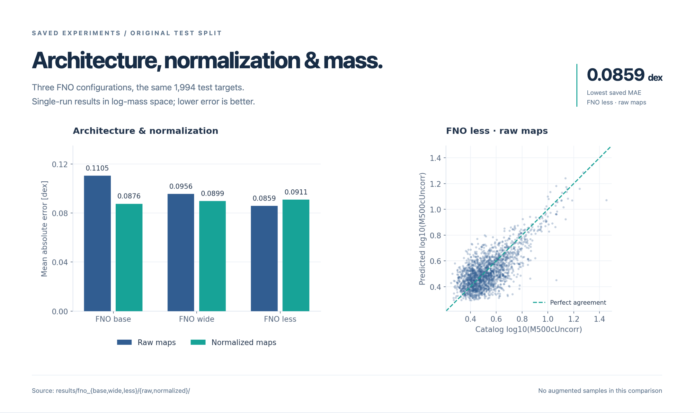

# Результаты экспериментов

[О проекте](../README.md) · [Навигатор по коду](notebooks.md) · [Воспроизведение](reproduction.md)

## Что измеряется

Целевая величина основных запусков — `log10(M500cUncorr)`, вычисленная из численного значения каталожной массы. Единицы исходного столбца сохраняются; преобразования в абсолютную массу в солнечных единицах в этом шаге нет.

Для каждой пары сохранённых массивов предсказания и метки выравниваются в одномерные векторы. Используются **попарные** ошибки:

```text
MAE  = mean(abs(prediction - target))
RMSE = sqrt(mean((prediction - target)²))
```

Обе метрики относятся к десятичному логарифму массы и выражены в dex. Вывод «относительная ошибка» в исходных ноутбуках делит ошибку на логарифмическую метку: его нельзя интерпретировать как процент ошибки физической массы.

## Сводная таблица

В каждой папке эксперимента находятся `losses.npy`, `targets.npy` и `predictions.npy`. В каждом включённом массиве loss — 100 значений. Метрики также сохранены в [results/metrics.json](../results/metrics.json).

| Эксперимент | N test | MAE, dex | RMSE, dex | Массивы |
| :--- | ---: | ---: | ---: | :--- |
| `fno_base/raw` | 1994 | 0.1105 | 0.1520 | [файлы](../results/fno_base/raw/) |
| `fno_base/normalized` | 1994 | 0.0876 | 0.1142 | [файлы](../results/fno_base/normalized/) |
| `fno_wide/raw` | 1994 | 0.0956 | 0.1281 | [файлы](../results/fno_wide/raw/) |
| `fno_wide/normalized` | 1994 | 0.0899 | 0.1166 | [файлы](../results/fno_wide/normalized/) |
| `fno_less/raw` | 1994 | 0.0859 | 0.1093 | [файлы](../results/fno_less/raw/) |
| `fno_less/normalized` | 1994 | 0.0911 | 0.1160 | [файлы](../results/fno_less/normalized/) |
| `fno_wide/normalized_augmented` | 2894 | 0.0849 | 0.1075 | [файлы](../results/fno_wide/normalized_augmented/) |
| `fno_less/normalized_augmented` | 2894 | 0.0934 | 0.1192 | [файлы](../results/fno_less/normalized_augmented/) |
| `fno_large/normalized_augmented` | 2894 | 0.0845 | 0.1061 | [файлы](../results/fno_large/normalized_augmented/) |
| `cnn/normalized_augmented` | 2894 | 0.1600 | 0.1909 | [файлы](../results/cnn/normalized_augmented/) |

Внутри исходной группы метки совпадают между запусками; в расширенной группе они также совпадают. Между группами выборки различаются. Дубли массивов удалены после проверки идентичности содержимого. Ранние варианты из `notebooks/exploration/` не включены: их загрузка и целевые величины отличаются.

## Наблюдения

- На исходной выборке лучшая MAE — **0.0859 dex** у FNO `less` без нормализации. Более глубокая архитектура не обязательно даёт меньшую ошибку.
- У FNO `base` нормализация снижает MAE с **0.1105 до 0.0876 dex** (примерно на 20.7%). Для `less` в сохранённом запуске нормализация ухудшает результат.
- В расширенной группе минимальная MAE — **0.0845 dex** у `large`, близко к `wide` с **0.0849 dex**. Без повторных запусков и оценки разброса нельзя утверждать значимость этой разницы.



На рисунке показана только исходная выборка без аугментации: слева — MAE трёх архитектур с исходными и нормализованными картами; справа — попарные предсказания `fno_less/raw`. Пунктирная диагональ соответствует точному совпадению с каталожной меткой.

## Границы сравнения

**Независимость скоплений.** Аугментация в `02_augment_clusters.ipynb` выполняется до разбиения в `03_split_dataset.ipynb`. Разбиение работает с индексами изображений и не группирует копии одного скопления. Возможное попадание связанных изображений в обе выборки может завышать оценку качества расширенных экспериментов. Для независимой проверки нужно делить по исходным скоплениям до создания аугментаций.

**CNN и формы тензоров.** В основном CNN-ноутбуке модель выдаёт `(batch, 1)`, а Dataset возвращает метки `(batch,)`. Вызов `MSELoss(pred, target)` и вычисление ошибок без согласования размерностей приводят к broadcasting. Табличные метрики выше вычислены попарно из сохранённых массивов после `reshape(-1)`; они не исправляют исходный процесс обучения. Поэтому CNN-строку следует рассматривать как результат текущей реализации, а не как строгое доказательство преимущества FNO над CNN.

**Нормализация и сохранённые артефакты.** В `notebooks/data/` нет полного шага создания нормализованных карт, поэтому проверить его статистики по имеющимся массивам нельзя. Веса моделей и полная конфигурация окружения не приложены. Подписи и соответствие архитектур взяты из ноутбуков обучения; идентичность сохранённых массивов конкретным весам независимо подтвердить нельзя.

**Протокол оценки.** В обучении test используется для промежуточной оценки каждые 10 эпох; отдельная validation-выборка не выделена. Нет повторов по нескольким seed, оценки неопределённости, отдельного итогового анализа по красному смещению и сравнения с `nemo`. Метки — каталожные оценки массы, поэтому совпадение с ними не является независимой проверкой истинной массы.

Эти особенности исходной реализации задокументированы. Архитектуры, алгоритмы обучения и численные артефакты при реструктуризации сохранены; обновлены пути, импорты и оформление визуализаций.

## Как проверить метрики

Из корня репозитория:

```python
from pathlib import Path
import numpy as np

folder = Path("results/fno_less/raw")
targets = np.load(folder / "targets.npy").astype(np.float64).reshape(-1)
preds = np.load(folder / "predictions.npy").astype(np.float64).reshape(-1)
assert targets.shape == preds.shape

errors = preds - targets
print(f"MAE:  {np.abs(errors).mean():.4f} dex")
print(f"RMSE: {np.sqrt(np.square(errors).mean()):.4f} dex")
```

Для остальных строк выберите папку эксперимента из таблицы.
